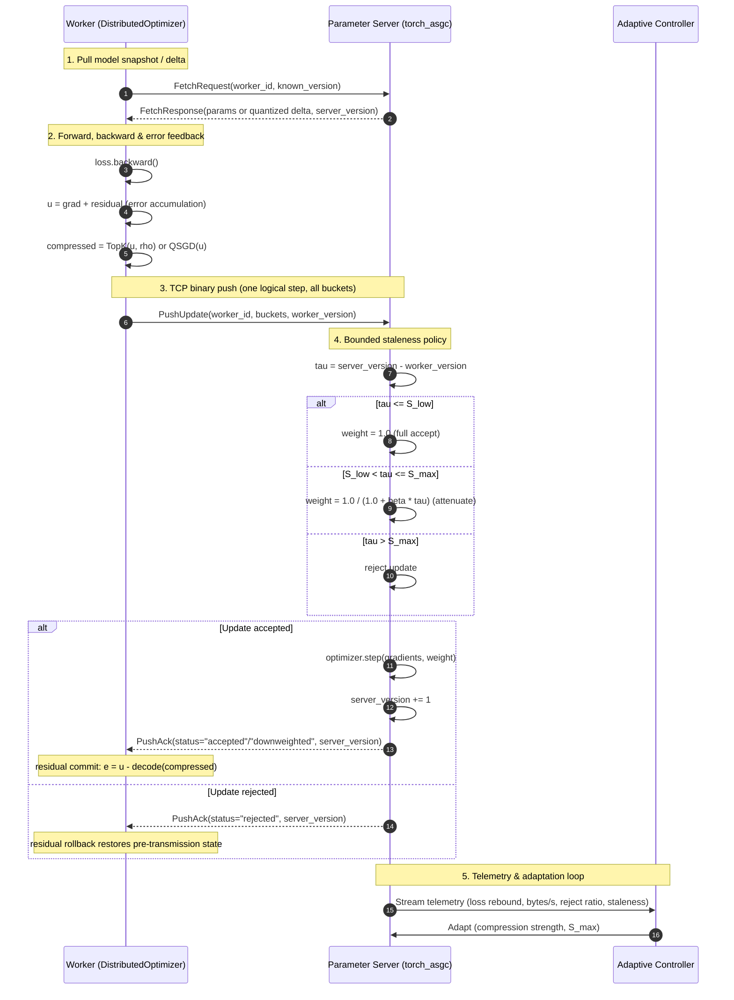

# torch-asgc: Adaptive Staleness-Aware Gradient Compression

[](https://www.python.org/downloads/)
[](https://pytorch.org/)
[](https://opensource.org/licenses/MIT)
[]()
[]()

**torch-asgc** is an asynchronous distributed deep learning training system that targets two core bottlenecks in data-parallel training:

1. **High communication overhead.** Transmitting full gradient vectors (44.7 MB per step for the CIFAR-10 ResNet-18 used here, gigabytes for LLMs) saturates network links.
2. **Worker heterogeneity and stragglers.** Compute and network variation force synchronous SGD to stall at global barriers, while unrestricted asynchronous SGD admits severely stale gradients that destabilize convergence.

It addresses both by jointly orchestrating **gradient compression with error feedback** and **staleness-aware bounded attenuation and rejection**, driven by real-time training telemetry.

This repository contains two complementary codebases:

- **`src/torch_asgc/` — the public library.** A decoupled PyTorch distributed training library (`DistributedModel`, `DistributedOptimizer`, `ParameterServer`) with real TCP transport, AMP, gradient bucketing, downlink delta broadcasting, local gradient accumulation, and plugins for PyTorch Lightning and Hugging Face. 29 unit tests cover these paths; the Hugging Face integration test also needs `accelerate`.
- **`src/asgc/` — the research simulation harness.** A deterministic multiprocess parameter-server simulation that injects worker delays and bandwidth limits, used to produce all empirical findings. See [`findings_for_report.md`](findings_for_report.md).

> **Hardware note.** Everything in this repository runs on CPU. The public-library tests and the **Fashion-MNIST** simulation (a 55k-parameter CNN) are comfortable on a laptop with no GPU. The **CIFAR-10 ResNet-18** experiments are compute-heavy and were run on a GPU; on a CPU-only machine, prefer the Fashion-MNIST configs below.

---

## 🏛 Architecture Overview



---

## ⚡ Capabilities

- **Decoupled public API.** Wraps any standard PyTorch `nn.Module` and any standard optimizer (`AdamW`, `SGD`, `Adam`, …) without taking over your training loop.
- **Real TCP socket transport.** Binary-framed networking (`TCPTransportClient`, `TCPTransportServer`) that scales beyond single-node multiprocessing, plus an in-process `LocalTransportHub` for tests.
- **Rejection-safe error feedback.** When an update is rejected for excessive staleness ($\tau > S_{max}$), the worker rolls its residual back to the pre-transmission state, so no gradient mass is silently lost.
- **Exact wire-byte accounting.** Payload sizes are computed at encode time — Top-K: 8 bytes/entry (float32 value + int32 index); QSGD: 1 byte/code + a float32 scale; Identity: 4 bytes/value — so the compression ratio cannot drift from what was actually transmitted.
- **Mixed precision (AMP).** `DistributedOptimizer.step(scaler=...)` unscales gradients, guards against Inf/NaN overflow, and safely skips the step on overflow.
- **Gradient bucketing.** Groups parameters into contiguous 1-D buffers for coalesced compression and transmission.
- **Downlink delta broadcasting.** The server sends INT8-quantized parameter deltas accumulated since a worker's last fetch instead of full snapshots.
- **Local gradient accumulation.** With `local_steps > 1`, the optimizer averages gradients across that many micro-batches before sending one compressed update. It does not call the base optimizer locally.
- **Framework plugins.** PyTorch Lightning (`ASGCStrategy`) and Hugging Face Trainer (`ASGCTrainerCallback`, `ASGCTrainer`, `wrap_hf_trainer`).

---

## 📊 Empirical Benchmark Results

All experiments use the research simulation (`src/asgc/`) under identical controlled worker heterogeneity and the same delay schedule per dataset; methods differ only by config. Every update, evaluation, and controller decision is logged to `results/<run>/events.jsonl`, the single source of truth for these numbers. The transformer slice (§5b of the findings) runs through the public `torch_asgc`/T4 path instead; its evidence is committed under [`artifacts/transformer_asgc/`](artifacts/transformer_asgc/). Single-seed runs are indicative; `configs/matrix_cifar_full.yaml` defines the multi-seed protocol but has not been run. Full data, findings F1–F17, and the deviations from the written methodology live in [`findings_for_report.md`](findings_for_report.md).

### 1. Fashion-MNIST straggler benchmark — CPU-friendly (small CNN, 3 workers, 3,000 updates)

Straggler schedule: worker 1 delayed by +0.3 s.

| Method | Test accuracy | Wall-clock | Data sent | Compression | Speedup vs sync |
|:---|:---:|:---:|:---:|:---:|:---:|
| Synchronous SGD | 86.11% | 274.3 s | 0.996 GB | 1.0× | 1.0× |
| Plain asynchronous SGD | 87.20% | 27.8 s | 0.664 GB | 1.0× | 9.9× |
| Async + fixed staleness | 87.03% | 41.1 s | 0.706 GB | 1.0× | 6.7× |
| Async + fixed Top-K (no EF) | 86.92% | 31.5 s | 0.332 GB | 2.0× | 8.7× |
| **Top-K + error feedback (ASGC)** | **87.47%** | 32.4 s | **0.332 GB** | 2.0× | 8.5× |
| Adaptive ASGC (post-fix controller) | 87.09% | 36.2 s | **0.195 GB** | **3.65×** | 7.6× |

> **Takeaway (F1, F2, F11):** Asynchrony is worth 9.9× wall-clock over averaged synchronous SGD under stragglers. Top-K + EF is the best fixed policy — the best accuracy of all six methods at exactly half the bytes. The post-fix adaptive controller goes further on bytes (3.65×) at equivalent accuracy within single-seed noise.

### 2. CIFAR-10 / ResNet-18 — unconstrained network (GPU, 3 workers, 6,000 updates)

Straggler schedule: worker 1 +0.5 s, worker 2 +1.5 s.

| Method | Test accuracy | Data sent | Compression | Throughput (upd/s) | Max eval drop |
|:---|:---:|:---:|:---:|:---:|:---:|
| Plain asynchronous SGD | 85.50% | 268.2 GB | 1.0× | 5.38 | 0.4 pts |
| Fixed Top-K (no EF) | 84.32% | 134.1 GB | 2.0× | 5.16 | 0.0 pts |
| **Top-K + error feedback (ASGC)** | **86.14%** | **134.1 GB** | **2.0×** | **5.00** | **0.0 pts** |
| Adaptive ASGC | 83.72% | **34.0 GB** | **8.13×** | 4.95 | 0.0 pts |

> **Takeaway (F5, F6):** Top-K + EF reaches +0.64 points accuracy over uncompressed async at half the bytes. Error feedback alone recovers +1.82 points over uncompensated Top-K on this harder model.

### 3. CIFAR-10 / ResNet-18 — 250 Mbps uplink constraint (GPU)

Each push is charged `payload_bytes / bandwidth`, modeling the gradient uplink.

| Method | Test accuracy | Wall-clock | Time to 80% | Data sent | Compression |
|:---|:---:|:---:|:---:|:---:|:---:|
| Plain asynchronous SGD | 86.01% | 70.4 min | 41.1 min | 268.2 GB | 1.0× |
| Fixed Top-K (no EF) | 84.60% | 54.0 min | 24.2 min | 134.1 GB | 2.0× |
| **Top-K + error feedback (ASGC)** | **86.50%** | **48.8 min** | **20.5 min** | 134.1 GB | 2.0× |
| Adaptive ASGC | 83.76% | **26.7 min** | **13.7 min** | **29.8 GB** | **9.01×** |

> **Takeaway (F8, F11):** Under bandwidth pressure, compression converts directly into wall-clock speedup — Top-K + EF reaches 80% accuracy 1.98× faster than plain async, and the adaptive controller reaches it 3.0× faster at 9.01× compression.

---

## 🚀 Quickstart: Public Library (`torch-asgc`)

### 1. Installation

```bash
git clone https://github.com/ksacheth/parallel-computing.git
cd parallel-computing

# Runtime + dev/experiment dependencies (CPU wheels of torch/torchvision)
pip install -r requirements.txt

# Install the public library in editable mode
pip install -e .
```

The default `torch`/`torchvision` wheels are CPU-only, which is all you need for the tests and the Fashion-MNIST experiments. GPU users should install a CUDA build instead, e.g.:

```bash
pip install torch torchvision --index-url https://download.pytorch.org/whl/cu128
```

### 2. Parameter server

```python
import torch
from torch_asgc import ParameterServer, StalenessConfig, AdaptiveConfig

model = MyModel(num_classes=10)                      # any nn.Module
optimizer = torch.optim.AdamW(model.parameters(), lr=1e-3, weight_decay=1e-4)

server = ParameterServer(
    model=model,
    optimizer=optimizer,
    bind_address="tcp://0.0.0.0:5555",               # or ("0.0.0.0", 5555)
    staleness_config=StalenessConfig(s_low=2, s_max=10, beta=0.5),
    compression_mode="topk",
    initial_strength=0.1,                            # 10% active fraction
    adaptive_config=AdaptiveConfig(enabled=True, interval_s=15.0),
)

print("ASGC parameter server listening on tcp://0.0.0.0:5555 ...")
server.serve_forever()
```

### 3. Distributed worker

Wrap your model and optimizer; `connect()` returns an `ASGCClient`.

```python
import torch
import torch.nn as nn
from torch.utils.data import DataLoader
from torch_asgc import DistributedModel, DistributedOptimizer, connect

# 1. Connect to the parameter server
client = connect("tcp://10.0.0.1:5555", worker_id="worker_0")

# 2. Standard PyTorch components
net = MyModel(num_classes=10)
criterion = nn.CrossEntropyLoss()
base_optimizer = torch.optim.AdamW(net.parameters(), lr=1e-3, weight_decay=1e-4)

# 3. Wrap with torch-asgc
model = DistributedModel(net, client=client)
optimizer = DistributedOptimizer(
    base_optimizer=base_optimizer,
    model=model,
    client=client,
    compression_mode="topk",
    rho=0.1,                   # Top-K active fraction (k/d)
    error_feedback=True,       # conserve residual gradient mass; rollback on reject is automatic
    local_steps=1,             # micro-batches averaged per compressed update
)

dataloader = DataLoader(my_dataset, batch_size=128, shuffle=True)

# 4. Standard training loop. optimizer.step() intercepts gradients, adds the
#    residual, compresses, pushes to the server, rolls back on rejection, and
#    re-syncs the model from the server.
for epoch in range(10):
    for x, y in dataloader:
        optimizer.zero_grad()
        loss = criterion(model(x), y)
        loss.backward()
        optimizer.step(loss_val=loss.item())
```

### 4. Mixed precision (AMP)

Pass the `GradScaler` straight into `step` — there is no separate AMP method.

```python
scaler = torch.cuda.amp.GradScaler()

for x, y in dataloader:
    x, y = x.cuda(), y.cuda()
    optimizer.zero_grad()
    with torch.cuda.amp.autocast():
        loss = criterion(model(x), y)

    scaler.scale(loss).backward()
    # step() unscales, checks for Inf/NaN, compresses, and updates residuals
    optimizer.step(scaler=scaler, loss_val=loss.item())
    scaler.update()
```

---

## 🔬 Research Simulation Benchmark Suite

The `src/asgc/` harness reproduces all findings and figures. Workers run as separate processes via the `spawn` start method (Windows-safe); entry points are guarded with `if __name__ == "__main__"`.

### Running tests

```bash
# Fast public-library suite (29 tests, ~30-45 s, CPU; HF test also needs accelerate)
python -m pytest tests/test_torch_asgc -q

# Full suite (library + research-simulation gates, including end-to-end runs)
python -m pytest tests/ -q
```

### Running experiments

On a machine without a GPU, stick to the Fashion-MNIST configs — the CIFAR-10 ResNet-18 runs are compute-heavy and intended for a GPU.

```bash
# Smoke test on Fashion-MNIST (3 workers)
python scripts/run_experiment.py --config configs/smoke_fmnist.yaml

# Fashion-MNIST headline methods, run individually
python scripts/run_experiment.py --config configs/comparisons/fmnist_headline/async_topk_ef.yaml
python scripts/run_experiment.py --config configs/comparisons/fmnist_headline/adaptive.yaml

# Fashion-MNIST headline matrix (six methods, 1 seed) via the sequential driver
python scripts/run_matrix.py --matrix configs/matrix_fmnist_headline.yaml

# CIFAR-10 ResNet-18 (GPU recommended)
python scripts/run_experiment.py --config configs/comparisons/cifar_slice/cifar_async_topk_ef.yaml
python scripts/run_experiment.py --config configs/comparisons/cifar_bandwidth/cifar_async_topk_ef_bw250.yaml
python scripts/run_matrix.py --matrix configs/matrix_cifar_full.yaml

# Aggregate logged runs into a summary table and figures
python scripts/plot_results.py --runs fmnist_sync_sgd fmnist_async_plain fmnist_async_topk_ef --target 0.85
```

`run_experiment.py` writes `results/<run.name>/events.jsonl`. `plot_results.py` reads those runs by name, prints a cross-run summary, writes `results/plot/summary.csv`, and renders comparison figures when matplotlib is available.

---

## 📁 Repository Structure

```text
parallel-computing/
├── src/
│   ├── torch_asgc/                  # Public distributed training library
│   │   ├── client.py                # connect() factory & ASGCClient
│   │   ├── server.py                # ParameterServer implementation
│   │   ├── model.py                 # DistributedModel parameter synchronization
│   │   ├── optim.py                 # DistributedOptimizer with EF & rollback
│   │   ├── compression.py           # CompressionConfig, Top-K, QSGD, Identity
│   │   ├── staleness.py             # Bounded staleness attenuation & filtering
│   │   ├── controller.py            # AdaptiveConfig & runtime adaptive tuning
│   │   ├── transport/               # base schemas, local hub, TCP binary transport
│   │   ├── engine/                  # bucketing, server optimizer, EF residual
│   │   └── plugins/                 # PyTorch Lightning & Hugging Face adapters
│   └── asgc/                        # Research simulation benchmark suite
│       ├── server.py                # Parameter-server process loop
│       ├── worker.py                # Worker process loop with delay injection
│       ├── transport.py             # Queue-based inter-process transport
│       ├── controller.py            # Adaptive controller
│       ├── compression.py / staleness.py
│       ├── metrics.py               # JSONL audit event schema
│       ├── data.py                  # Dataset partitioning
│       └── models/                  # SmallCNN (MNIST) & ResNet-18 (CIFAR)
├── configs/                         # Declarative experiment configs
│   ├── smoke_*.yaml                 # Fast smoke tests (Fashion-MNIST)
│   ├── baselines/                   # CIFAR sync, plain async, fixed Top-K/staleness
│   ├── adaptive/                    # Adaptive-controller configs + ablations
│   ├── comparisons/
│   │   ├── fmnist_headline/         # Six Fashion-MNIST methods
│   │   ├── cifar_slice/             # CIFAR Top-K + EF
│   │   └── cifar_bandwidth/         # 250 Mbps bandwidth-constrained CIFAR
│   ├── matrix_fmnist_headline.yaml  # Fashion-MNIST headline matrix
│   └── matrix_cifar_full.yaml       # Full CIFAR evaluation matrix
├── docs/                            # Specs, per-stage plans, research notes, slides
│   ├── methodology.tex              # Formal algorithm specification & math
│   ├── proposal.tex                 # Research proposal & evaluation plan
│   ├── public_interface_gap_analysis.md
│   ├── downlink_optimization_research.md
│   └── plans/                       # Implementation plans for stages 1–6
├── scripts/
│   ├── run_experiment.py            # Single experiment (--config)
│   ├── run_matrix.py                # Multi-config/seed driver (--matrix)
│   └── plot_results.py              # Summary tables & figures (--runs)
├── notebooks/                       # Transformer CUDA run + frozen FMNIST/CIFAR results
├── artifacts/transformer_asgc/      # Committed transformer evidence bundles
├── CONTEXT.md                       # Canonical domain glossary and vocabulary
├── findings_for_report.md           # Full experimental report, findings F1–F17
├── AGENTS.md                        # Agent/contributor guide
├── requirements.txt                 # Runtime + experiment dependencies
└── pyproject.toml                   # Package build (pip install -e .)
```

---

## 📚 Key References

1. Li et al., *Scaling Distributed Machine Learning with the Parameter Server*, OSDI 2014.
2. Lian et al., *Asynchronous Parallel Stochastic Gradient Descent on Non-Convex Problems*, NeurIPS 2015.
3. Ho et al., *More Effective Distributed ML via a Stale Synchronous Parallel Parameter Server*, NeurIPS 2013.
4. Zhang et al., *Staleness-aware Async-SGD for Distributed Deep Learning*, IJCAI 2016.
5. Alistarh et al., *QSGD: Communication-Efficient SGD via Gradient Quantization and Encoding*, NeurIPS 2017.
6. Lin et al., *Deep Gradient Compression*, ICLR 2018.
7. Karimireddy et al., *Error Feedback Fixes SignSGD and other Gradient Compression Methods*, ICML 2019.
8. Islamov et al., *Asynchronous Distributed Methods for Empirical Risk Minimization*, ICML 2024.

---

## 📄 License

MIT License — see [LICENSE](LICENSE) for details.
